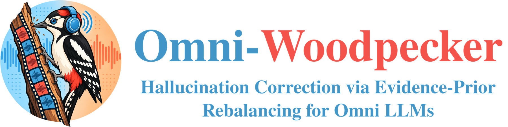
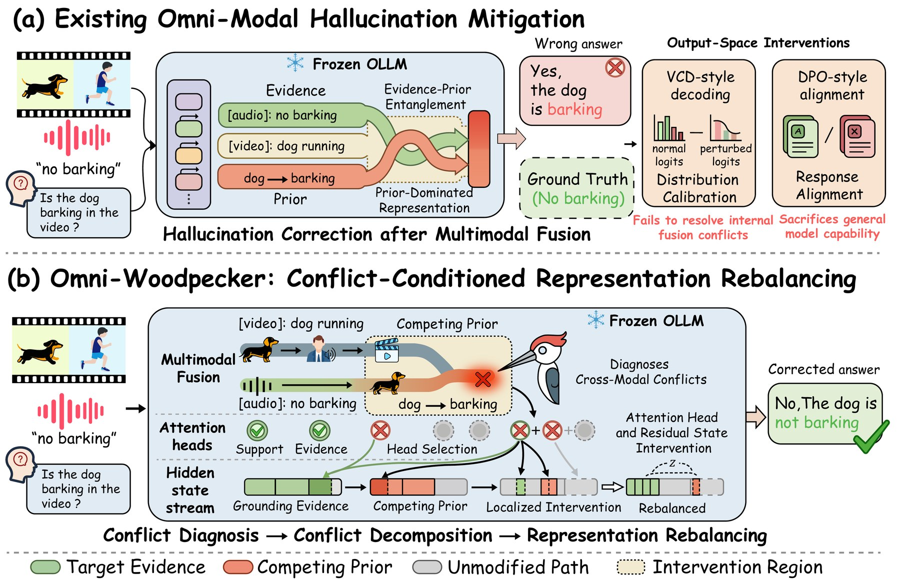
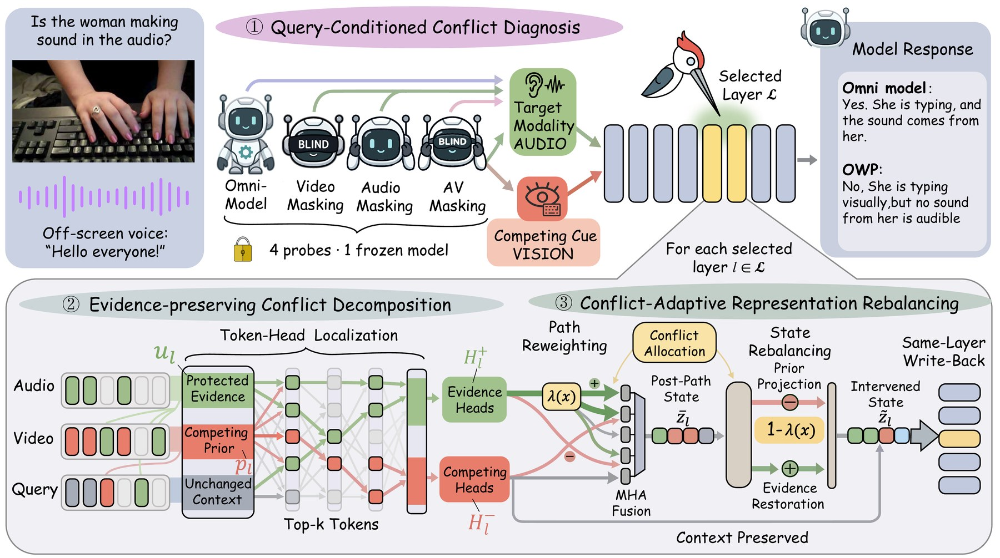
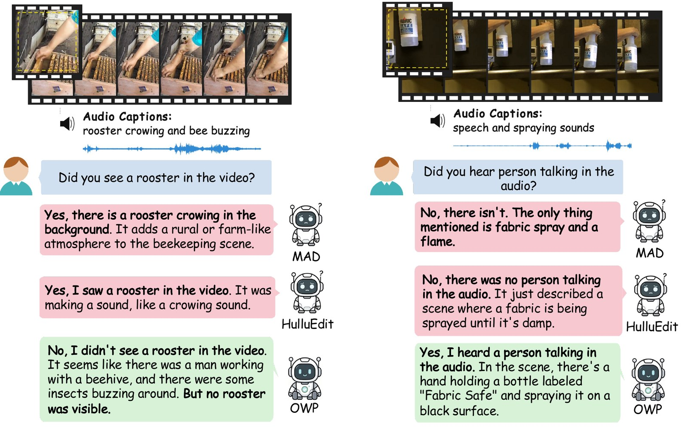

<!-- LOGO: <p align="center"></p> -->

<h1 align="center">Omni-Woodpecker: Hallucination Correction via<br>Evidence-Prior Rebalancing for Omni LLMs</h1>

<p align="center">
  <a href="https://arxiv.org/abs/XXXX.XXXXX"></a>
  <a href="https://github.com/ZiiJianLiu/Omni-Woodpecker"></a>
  <a href="LICENSE"></a>
  
  <a href="https://huggingface.co/Qwen/Qwen2.5-Omni-7B"></a>
  <a href="https://huggingface.co/DAMO-NLP-SG/VideoLLaMA2.1-7B-AV"></a>
</p>

<p align="center">
  <a href="https://github.com/ZiiJianLiu">Zijian Liu</a><sup>1</sup>,
  Chaoyou Fu<sup>1✉</sup>,
  Yan Yang<sup>1</sup>,
  Caifeng Shan<sup>1</sup>,
  Ran He<sup>2</sup>
  <br>
  <sup>1</sup>School of Intelligence Science and Technology, Nanjing University &nbsp;&nbsp;
  <sup>2</sup>University of Chinese Academy of Sciences
  <br>
  <sup>✉</sup>Corresponding author
</p>

<p align="center">
  <a href="#-overview">Overview</a> &nbsp;•&nbsp;
  <a href="#-evaluation">Evaluation</a> &nbsp;•&nbsp;
  <a href="#%EF%B8%8F-preliminary">Preliminary</a> &nbsp;•&nbsp;
  <a href="#-usage">Usage</a> &nbsp;•&nbsp;
  <a href="#-citation">Citation</a>
</p>

<p align="center"><i>TL;DR: OWP corrects cross-modal hallucinations in omni-modal LLMs by finding which modality<br>the query needs, then rebalancing evidence and priors inside the frozen model, with no training.</i></p>

<p align="center">
    
</p>

-----------------

## 🔥 News

- **[2026-10]** 🎉 The paper and code of Omni-Woodpecker are released.


## 📖 Overview

> Recent Omni LLMs (OLLMs) have demonstrated remarkable capabilities in joint audio-visual reasoning, yet cross-modal hallucinations remain a major challenge. Existing mitigation methods mainly operate at the output level, overlooking the entanglement of grounding evidence and learned priors within fused representations. To address this issue, we propose Omni-Woodpecker (OWP), a training-free framework that shifts hallucination mitigation from output-level manipulation to conflict-conditioned representation rebalancing. Specifically, OWP first identifies cross-modal conflicts from complementary modality-specific views. It then employs orthogonal decomposition to separate grounding evidence from competing priors within the hidden states. Finally, OWP adaptively rebalances fused representations by suppressing misleading priors and restoring ignored evidence before decoding. Extensive experiments demonstrate the effectiveness and strong cross-architecture generalization of OWP. Using Qwen2.5-Omni-7B as the backbone, OWP improves performance by 12.9 and 8.6 points on CMM and AVHBench, respectively, while consistently achieving gains of 0.67–2.25 points across four general OLLM reasoning benchmarks. Furthermore, OWP generalizes effectively to VideoLLaMA2-AV, improving performance by 4.6 and 3.9 points on the same benchmarks.

<table>
  <tr>
    <td width="33%" valign="top"><b>🔍 Conflict Diagnosis</b><br>Identify the modality that the query needs and the stream that competes with it, from four views of the frozen model.</td>
    <td width="33%" valign="top"><b>🧩 Evidence-Prior Decomposition</b><br>Separate grounding evidence from competing priors in the hidden states through orthogonal decomposition.</td>
    <td width="33%" valign="top"><b>⚖️ Training-Free Rebalancing</b><br>Suppress misleading priors and restore ignored evidence before decoding, without changing any model parameter.</td>
  </tr>
</table>

<p align="center">
    
</p>

If you have any question, please feel free to open an issue or email bradyfu24@gmail.com.


## 🌋 Evaluation

We perform experiments on two frozen omni-modal backbones:
- [Qwen2.5-Omni-7B](https://huggingface.co/Qwen/Qwen2.5-Omni-7B), [VideoLLaMA2-AV](https://huggingface.co/DAMO-NLP-SG/VideoLLaMA2.1-7B-AV)

The experimental results are shown below. For more details, please check out [our paper](https://arxiv.org/abs/XXXX.XXXXX).

### 📍 CMM and AVHBench Result

This part focuses on cross-modal hallucinations. PA and HR are CMM perception accuracy and hallucination resistance. Values in parentheses are gains over the backbone, and bold marks the best result for each backbone.

| Backbone | Method | CMM Acc. | CMM PA | CMM HR | AVHBench Acc. | AVHBench F1 |
| --- | --- | :---: | :---: | :---: | :---: | :---: |
| Qwen2.5-Omni-7B | Backbone | 73.2 | 89.5 | 57.0 | 75.1 | 76.3 |
| | AVCD | 74.8 | 83.5 | 66.0 | 74.8 | 72.0 |
| | MAD | 81.2 | **89.7** | 72.8 | 76.0 | 75.0 |
| | HulluEdit | 79.2 | 86.2 | 72.3 | 71.6 | 66.4 |
| | **OWP (ours)** | **86.1 (+12.9)** | 86.7 | **85.5** | **83.7 (+8.6)** | **83.3** |
| VideoLLaMA2-AV | Backbone | 76.2 | 87.2 | 65.3 | 70.2 | 72.9 |
| | AVCD | 77.9 | 85.0 | 70.8 | 72.1 | **73.9** |
| | MAD | 79.2 | **88.0** | 70.3 | 70.0 | 71.7 |
| | HulluEdit | 77.2 | 82.2 | 72.2 | 71.7 | 70.1 |
| | **OWP (ours)** | **80.8 (+4.6)** | 83.8 | **77.7** | **74.1 (+3.9)** | **73.9** |

### 📍 General Omni-Modal Reasoning Result

This part focuses on general omni-modal reasoning with Qwen2.5-Omni-7B.

| Model | OmniBench | WorldSense | MUSIC-AVQA | AVQA |
| --- | :---: | :---: | :---: | :---: |
| Qwen2.5-Omni-7B | 45.36 | 45.21 | 85.08 | 91.83 |
| **+ OWP** | **47.29 (+1.93)** | **47.46 (+2.25)** | **86.08 (+1.00)** | **92.50 (+0.67)** |

### 📍 Qualitative Result

Audio cues lead the baselines to report a visually absent rooster, whereas visual cues lead them to deny concurrent speech. OWP answers each query from the modality it asks about.

<p align="center">
    
</p>


## 🛠️ Preliminary

1. Create conda environment

```bash
git clone https://github.com/ZiiJianLiu/Omni-Woodpecker.git
cd Omni-Woodpecker
conda create -n owp python=3.10
conda activate owp
pip install -r requirements.txt
pip install -e .
```

2. Prepare the backbones

| Backbone | `--model` | Checkpoint | Config |
| --- | --- | --- | --- |
| VideoLLaMA2-AV (default) | `videollama2` | [DAMO-NLP-SG/VideoLLaMA2.1-7B-AV](https://huggingface.co/DAMO-NLP-SG/VideoLLaMA2.1-7B-AV) | `configs/videollama2-7b-av.json` |
| Qwen2.5-Omni-7B | `qwen` | [Qwen/Qwen2.5-Omni-7B](https://huggingface.co/Qwen/Qwen2.5-Omni-7B) | `configs/qwen2.5-omni-7b.json` |

Checkpoints are downloaded from Hugging Face on first use and cached in `~/.cache/omni-woodpecker` (set `OWP_CACHE_DIR` to change it, or pass a local checkpoint with `--model-path`). A GPU with at least 24 GB of memory is required in BF16; use `--dtype float16` when BF16 is unavailable.

3. (Optional) Check the installation

```bash
python tools/validate_release.py
python -m unittest discover -s tests
```


## ⭐ Usage

**1. Inference**

To correct hallucinations for a set of audio-visual questions, run the inference code as follows. The bundled example contains three CMM requests and their media, so it runs right after cloning:

```bash
CUDA_VISIBLE_DEVICES=0 python src/owp_infer.py \
        --input sample_data/owp_input.jsonl \
        --output results/owp_output.jsonl \
        --model videollama2
```

Use `--model qwen` to run OWP on Qwen2.5-Omni-7B with the same input and output format.

***

**2. Python API**

```python
from owp import correct

results = correct(
    "sample_data/owp_input.jsonl",
    "results/owp_output.jsonl",
    model="videollama2",
)
for result in results:
    print(result["sample_id"], result["answer"], result["status"])
```

A complete script is provided in `examples/run_inference.py`.

<details>
<summary><b>Input and output format</b></summary>

Each input line is a JSON object with `sample_id`, a Yes/No `question`, and at least one of `video_path` and `audio_path`. Paths may be relative to the repository root. Each output line contains `sample_id`, the corrected `answer`, `status`, and `error` (null on success). `sample_data/owp_expected_output.jsonl` illustrates the output format.

To run the full benchmarks, CMM media are downloaded automatically. AVHBench media require local files or a Hugging Face dataset specified by `OWP_AVHBENCH_DATASET_ID`.

</details>

<details>
<summary><b>Code structure</b></summary>

| Paper component | Files |
| --- | --- |
| Entry points | `owp/api.py`, `src/owp_infer.py` |
| Four-view conflict diagnosis | `src/intervention.py`, `src/run_owp.py`, `src/probe_videollama2.py` |
| Query-conditioned target typing | `src/probe_qwen.py`, `src/probe_videollama2.py` |
| Evidence-prior decomposition | `src/intervention.py`, `src/intervention_videollama2.py` |
| Token-head and residual rebalancing | `src/intervention.py`, `src/intervention_videollama2.py` |
| Qwen2.5-Omni backbone | `owp/models/qwen_omni.py` |

A standard OWP run performs four diagnostic forward passes and one edited forward pass. All intervention coefficients are stored in `configs/owp_default.json`. See [CODE_MAP.md](CODE_MAP.md) for the main symbols of each component.

</details>


## 🌻 Acknowledgement

This repository benefits from [Qwen2.5-Omni](https://github.com/QwenLM/Qwen2.5-Omni), [VideoLLaMA2](https://github.com/DAMO-NLP-SG/VideoLLaMA2), and [Woodpecker](https://github.com/BradyFU/Woodpecker). We also thank the authors of CMM, AVHBench, AVCD, MAD, and HulluEdit for making their work available.


## 📜 License

The source code is released under the [MIT License](LICENSE). The bundled VideoLLaMA2 runtime in `third_party/VideoLLaMA2/` keeps its upstream copyright headers. Model checkpoints and benchmark data retain their own licenses; see [docs/ASSET_NOTICES.md](docs/ASSET_NOTICES.md).


## 📑 Citation

If you find our project helpful to your research, please consider citing:

```bibtex
@article{liu2026omniwoodpecker,
  title={Omni-Woodpecker: Hallucination Correction via Evidence-Prior Rebalancing for Omni LLMs},
  author={Liu, Zijian and Fu, Chaoyou and Yang, Yan and Shan, Caifeng and He, Ran},
  journal={arXiv preprint arXiv:XXXX.XXXXX},
  year={2026}
}
```
